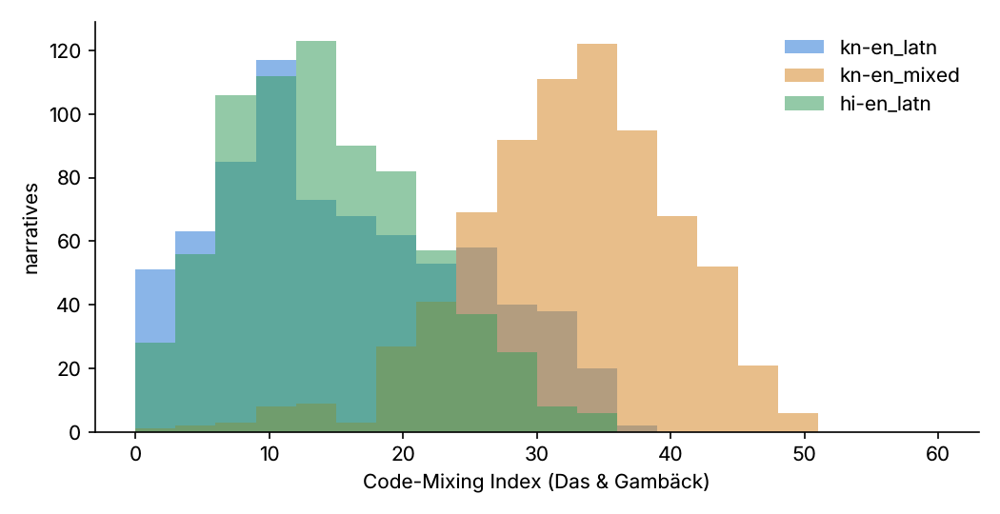

# LexVaani-IN dataset statistics (v0.1)

Generated by `make stats` from the release files.

## Size

- Scenario specs: **724** (base + minimal-pair siblings; 6 duplicate specs removed at export)
- Clean narratives: **4344** · ASR-noisy narratives: **2003** · dialogues: **4344**
- Dialogue turns: **39242** · oracle decision points: **13446**
- Explanation references: **7224**

## Splits (clean narratives)

### split

| value | count | % |
|---|---|---|
| train | 2778 | 64.0 |
| test | 1014 | 23.3 |
| dev | 552 | 12.7 |

## Distributions (clean narratives)

### domain (multi-issue samples count once per domain)

| value | count | % |
|---|---|---|
| criminal | 1134 | 23.3 |
| cyber | 894 | 18.4 |
| property | 816 | 16.8 |
| consumer_financial | 798 | 16.4 |
| family | 780 | 16.0 |
| (none: out-of-scope / non-legal) | 444 | 9.1 |

### issue (multi-label)

| value | count | % |
|---|---|---|
| crim.police_refusal_fir | 348 | 6.7 |
| crim.criminal_intimidation | 300 | 5.8 |
| fam.maintenance | 234 | 4.5 |
| x.out_of_scope | 228 | 4.4 |
| con.refund_refusal | 222 | 4.3 |
| cyb.upi_payment_fraud | 222 | 4.3 |
| x.non_legal | 216 | 4.1 |
| crim.cheating | 210 | 4.0 |
| cyb.impersonation | 192 | 3.7 |
| fin.unauthorized_bank_txn | 192 | 3.7 |
| prop.boundary_dispute | 192 | 3.7 |
| fam.divorce | 186 | 3.6 |
| crim.hurt_assault | 180 | 3.5 |
| con.defective_product | 174 | 3.3 |
| fam.custody | 174 | 3.3 |
| fam.dowry_harassment | 174 | 3.3 |
| prop.forged_documents | 174 | 3.3 |
| cyb.phishing_account_takeover | 168 | 3.2 |
| prop.coheir_sale_without_consent | 168 | 3.2 |
| con.deficiency_in_service | 162 | 3.1 |
| cyb.cyberstalking | 162 | 3.1 |
| fam.domestic_violence | 162 | 3.1 |
| prop.encroachment | 162 | 3.1 |
| crim.theft | 156 | 3.0 |
| prop.inheritance_partition | 156 | 3.0 |
| cyb.morphed_intimate_image | 150 | 2.9 |
| fin.loan_recovery_harassment | 150 | 2.9 |

### language / script variant

| value | count | % |
|---|---|---|
| en | 724 | 16.7 |
| hi | 724 | 16.7 |
| hi-en_latn | 724 | 16.7 |
| kn | 724 | 16.7 |
| kn-en_latn | 724 | 16.7 |
| kn-en_mixed | 724 | 16.7 |

### variation

| value | count | % |
|---|---|---|
| multi_issue | 870 | 20.0 |
| high_risk | 834 | 19.2 |
| complete | 810 | 18.6 |
| incomplete | 786 | 18.1 |
| contradictory | 600 | 13.8 |
| out_of_scope | 228 | 5.2 |
| non_legal | 216 | 5.0 |

### difficulty

| value | count | % |
|---|---|---|
| medium | 2130 | 49.0 |
| easy | 1164 | 26.8 |
| hard | 1050 | 24.2 |

## Lengths

| variant | mean chars | median chars | mean tokens | max tokens |
|---|---|---|---|---|
| en | 381 | 355 | 73.1 | 159 |
| hi | 366 | 340 | 76.1 | 162 |
| hi-en_latn | 415 | 384 | 75.3 | 160 |
| kn | 370 | 343 | 54.4 | 114 |
| kn-en_latn | 397 | 369 | 55.8 | 118 |
| kn-en_mixed | 383 | 356 | 58.8 | 126 |

Dialogues: mean 9.0 turns (max 18).

## Code-Mixing Index

| variant | mean | median | min | max |
|---|---|---|---|---|
| en | 0.04 | 0.0 | 0.0 | 6.67 |
| kn | 0.0 | 0.0 | 0.0 | 0.0 |
| hi | 0.0 | 0.0 | 0.0 | 0.0 |
| kn-en_latn | 15.49 | 13.79 | 0.0 | 36.67 |
| kn-en_mixed | 32.44 | 32.89 | 0.0 | 50.0 |
| hi-en_latn | 14.22 | 13.66 | 0.0 | 34.69 |

## Label balance

### T6 epistemic status (facts)

| value | count | % |
|---|---|---|
| reported | 21870 | 88.3 |
| evidence_supported | 1710 | 6.9 |
| conflicting | 1200 | 4.8 |

### T6 hedged facts

| value | count | % |
|---|---|---|
| False | 23370 | 94.3 |
| True | 1410 | 5.7 |

### T7 element values (narrative-level)

| value | count | % |
|---|---|---|
| satisfied | 10026 | 60.2 |
| unknown | 5100 | 30.6 |
| contradicted | 1530 | 9.2 |

### T2 entity types

| value | count | % |
|---|---|---|
| PERSON | 11599 | 38.1 |
| TIME | 5478 | 18.0 |
| EVIDENCE | 4770 | 15.7 |
| ORGANIZATION | 3776 | 12.4 |
| ASSET | 2124 | 7.0 |
| ACCOUNT | 1128 | 3.7 |
| MONEY | 1026 | 3.4 |
| IDENTIFIER | 306 | 1.0 |
| LOCATION | 258 | 0.8 |

### T2 mention kinds

| value | count | % |
|---|---|---|
| nominal | 15446 | 50.7 |
| value | 6810 | 22.4 |
| name | 5660 | 18.6 |
| pronoun | 2549 | 8.4 |

### T3 events: negated / hypothetical / asserted

| value | count | % |
|---|---|---|
| asserted | 6558 | 82.2 |
| negated | 1416 | 17.7 |
| hypothetical | 6 | 0.1 |

### T4 TIMEX types

| value | count | % |
|---|---|---|
| date | 4500 | 82.1 |
| duration | 372 | 6.8 |
| time | 348 | 6.4 |
| set | 258 | 4.7 |

### T4 TLINK relations

| value | count | % |
|---|---|---|
| BEFORE | 3372 | 74.3 |
| OVERLAP | 1164 | 25.7 |

### T12 clarification labels

| value | count | % |
|---|---|---|
| new_fact | 13446 | 86.8 |
| reexplain_request | 1613 | 10.4 |
| correction | 436 | 2.8 |

### T13 triage

| value | count | % |
|---|---|---|
| lawyer | 1908 | 43.9 |
| self_help | 1278 | 29.4 |
| urgent | 1158 | 26.7 |

### T13 risk flags

| value | count | % |
|---|---|---|
| imminent_violence | 228 | 21.6 |
| imminent_property_transfer | 168 | 15.9 |
| threat_to_life | 162 | 15.3 |
| golden_hour_fraud | 126 | 11.9 |
| image_circulation | 90 | 8.5 |
| self_harm | 78 | 7.4 |
| ongoing_abuse | 66 | 6.2 |
| eviction_imminent | 54 | 5.1 |
| child_removal_imminent | 42 | 4.0 |
| limitation_near_expiry | 42 | 4.0 |

### minimal-pair flip types (specs)

| value | count | % |
|---|---|---|
| element_flip | 38 | 25.3 |
| evidence_flip | 38 | 25.3 |
| date_regime_flip | 37 | 24.7 |
| risk_flip | 37 | 24.7 |

### law regime (specs with criminal-law routing)

| value | count | % |
|---|---|---|
| new | 309 | 74.6 |
| old | 105 | 25.4 |

## Fairness slices (clean narratives)

Slice variables are sampled independently of narrative style (no stereotyped language is tied to them).

### speaker gender

| value | count | % |
|---|---|---|
| female | 2610 | 60.1 |
| male | 1734 | 39.9 |

### speaker age_group

| value | count | % |
|---|---|---|
| 26-40 | 1638 | 37.7 |
| 41-60 | 1164 | 26.8 |
| 18-25 | 1062 | 24.4 |
| 60+ | 480 | 11.0 |

### speaker settlement

| value | count | % |
|---|---|---|
| urban | 2706 | 62.3 |
| rural | 1638 | 37.7 |

### speaker region

| value | count | % |
|---|---|---|
| bengaluru | 942 | 21.7 |
| malnad | 798 | 18.4 |
| kittur_karnataka | 690 | 15.9 |
| kalyana_karnataka | 678 | 15.6 |
| coastal | 618 | 14.2 |
| old_mysuru | 618 | 14.2 |

### speaker religion

| value | count | % |
|---|---|---|
| not_recorded | 3888 | 89.5 |
| hindu | 354 | 8.1 |
| muslim | 54 | 1.2 |
| christian | 24 | 0.6 |
| interfaith_sma | 24 | 0.6 |

### speaker literacy_proxy

| value | count | % |
|---|---|---|
| medium | 2046 | 47.1 |
| high | 1224 | 28.2 |
| low | 1074 | 24.7 |

## Inter-annotator agreement

**Not yet available.** The double-annotation subset (≥15% of narratives, two annotators each) is exported to `annotation/labelstudio/tasks_double.json`. Agreement (Cohen's/Fleiss' κ for categorical labels, span-F1 for spans, graph-F1 for Case Graphs) will be computed with `python -m lexvaani.annotation.iaa` and reported here. No numbers are estimated in advance.
