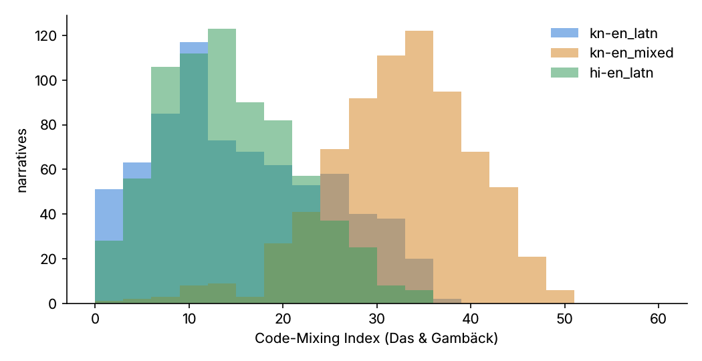

# LexVaani-IN QC report (v0.1, automatic checks)

Generated by `make qc`. Raw numbers: `reports/qc_results.json`.

## 1. Schema validation and offset alignment

| Object | Count | Failed validation |
|---|---|---|
| specs | 730 | 0 |
| narratives | 4380 | 0 |
| asr | 2009 | 0 |
| dialogues | 4380 | 0 |

Every span (entities, triggers, timexes, facts, cues) is re-verified against the text on load: **68787** spans in clean narratives, **0** misaligned. Offsets are produced during rendering, never searched for.

## 2. Script / language ID

Heuristic variant identification (script ratios + project vocabularies). This is a consistency check, not an independent LID model.

| Variant | Accuracy |
|---|---|
| en | 1.000 |
| kn | 1.000 |
| hi | 1.000 |
| kn-en_latn | 1.000 |
| kn-en_mixed | 1.000 |
| hi-en_latn | 1.000 |

## 3. Code-Mixing Index

| Variant | mean | median | min | max |
|---|---|---|---|---|
| en | 0.04 | 0.0 | 0.0 | 6.67 |
| kn | 0.0 | 0.0 | 0.0 | 0.0 |
| hi | 0.0 | 0.0 | 0.0 | 0.0 |
| kn-en_latn | 15.49 | 13.79 | 0.0 | 36.67 |
| kn-en_mixed | 32.44 | 32.89 | 0.0 | 50.0 |
| hi-en_latn | 14.22 | 13.66 | 0.0 | 34.69 |

## 4. Near-duplicates

Word-trigram Jaccard between narratives of the same issue and variant from *different* families: 57366 pairs, mean 0.205, **21** pairs ≥ 0.9.

Template-based generation makes narratives of the same issue lexically similar by design; the split is by family so this does not leak labels, but it limits lexical diversity (see DATASHEET, limitations).

## 5. Cross-lingual meaning preservation

All six variants of a spec must carry identical labels (issues, elements, events, timex values, facts, triage, provisions, graph shape): **730 / 730** specs consistent.

Embedding similarity / back-translation: not run: needs LaBSE / IndicTrans2 downloads (see qc/external.py).

## 6. Citation validity

- Basis for validity: **corpus** (parsed official corpus)
- Gold citations: 14448; valid against basis: 13512
- Found in the parsed corpus: **10584** (corpus sections: 2747)
- Registry entries verified by a human: **0 / 79** — Gate 1 pending

## 7. Label leakage

- Narratives mentioning a statute / section number: **0** of 4380
- Glossary legal-term hits (informal narratives should rarely use these): {"ancestral_property": 54, "cruelty_498a": 24, "hurt": 3}

## 8. Dialogues

- 4380 dialogues, 13446 oracle decision points
- T12 labels: {"new_fact": 13446, "reexplain_request": 1613, "correction": 436}
- Mean case completeness after the dialogue: 0.925

## 9. LLM-as-judge

Status: **not run** — requires GEN/JUDGE API keys; code in src/lexvaani/llm/judge.py, prompts/judge_v1.md.

## 10. Human annotation and IAA

Status: **pending**. annotation/labelstudio/tasks_double.json (>=15%, 2 annotators each). IAA: to be computed with `python -m lexvaani.annotation.iaa` once annotations exist. No agreement numbers are reported until real annotations exist.

